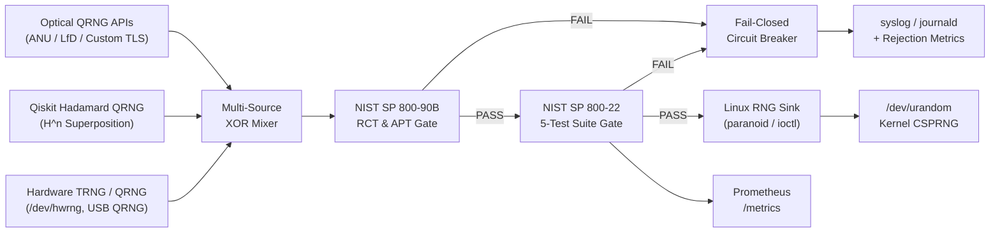

# `qentropyd` — Self-Verifying Quantum Entropy Daemon for Linux

[](LICENSE)
[](https://www.python.org/)
[](https://kernel.org/)
[](docs/STATISTICAL_TESTS.md)
[](docs/OPERATOR_MANUAL.md)
[](https://github.com/PelleNybe/qentropyd/actions/workflows/ci.yml)

**Zero-trust, self-verifying quantum entropy conditioning for Linux servers, HSMs, cloud VMs, and edge nodes.**

Modern cryptography fails silently when entropy degrades. `qentropyd` harvests raw random bitstreams from **independent quantum and hardware entropy sources** (optical QRNG APIs, Qiskit $H^{\otimes n}$ quantum circuits, and Linux `/dev/hwrng` devices), cryptographically XOR-mixes them, and gates **every single batch** through **NIST SP 800-90B** continuous health tests and **NIST SP 800-22** statistical tests before a single byte ever reaches `/dev/urandom`.

If any source stalls, drifts, or exhibits periodic bias, the **fail-closed circuit breaker** immediately discards the batch, alerts `syslog`/`journald`, and exports Prometheus telemetry—guaranteeing bad entropy never touches your kernel CSPRNG.

---

## Architecture & Dataflow



---

## Key Capabilities

- **Multi-Source Cryptographic XOR Mixing (`MultiSourceXorMixer`):** Combines equal-length byte streams from optical QRNGs, Qiskit quantum circuits, and `/dev/hwrng` hardware devices. By the one-time-pad principle, as long as *at least one* source is genuine and uncompromised, the mixed output remains unpredictable.
- **No Premature Whitening:** NIST SP 800-90B & SP 800-22 validation runs *prior* to kernel mixing without masking dead hardware behind a hash/PRNG—so stuck-at-zero, periodic, or biased hardware fails loudly.
- **Fail-Closed Circuit Breaker:** Any statistical or health test failure immediately discards the buffer, increments `qentropyd_batches_rejected_total{reason=...}`, logs to `syslog`/`journald`, and enters exponential backoff / cooldown.
- **Privilege-Separated Linux Integration:**
  - **`paranoid` mode (default):** Writes verified bytes directly to `/dev/urandom` under `DynamicUser=yes` with an empty `CapabilityBoundingSet=` (zero capabilities).
  - **`credit` mode:** Uses `ioctl(RNDADDENTROPY)` (`0x40085203`) with strictly scoped `CAP_SYS_ADMIN` for entropy-starved VMs and embedded boot environments.
- **Automation & Observability:** Native Prometheus `/metrics` endpoint, `SIGHUP` hot-reload, and `--json` CLI output for CI/CD, Ansible, and monitoring probes.

---

## Quickstart

```bash
# 1. Install qentropyd
pip install .

# 2. Run the NIST SP 800-90B & SP 800-22 self-check (human-readable or --json)
qentropyd self-check --bytes 4096
qentropyd self-check --bytes 4096 --json

# 3. Validate production configuration & probe configured sources
qentropyd -c systemd/qentropyd.example.yaml validate-config
qentropyd -c systemd/qentropyd.example.yaml test-sources

# 4. Run the daemon
qentropyd -c systemd/qentropyd.example.yaml run
```

---

## Deep Dive

<details>
<summary><strong>Implemented NIST SP 800-22 &amp; SP 800-90B Tests &amp; Thresholds</strong></summary>

| Standard | Test | Purpose | Default Threshold |
| :--- | :--- | :--- | :--- |
| **SP 800-90B** | Repetition Count Test (RCT) | Stuck-at fault detection (byte + bit level) | $H = 4.0$, $\alpha = 2^{-20}$ ($C = 6$) |
| **SP 800-90B** | Adaptive Proportion Test (APT) | Symbol dominance over $W = 512$ window | Exact binomial cutoff ($\alpha = 2^{-20}$) |
| **SP 800-22** | Frequency (Monobit) Test | Global 0/1 balance | $P \ge 0.01$ |
| **SP 800-22** | Block Frequency Test | Local 0/1 balance ($M = 128$) | $P \ge 0.01$ |
| **SP 800-22** | Runs Test | Oscillation rate &amp; monobit prerequisite | $P \ge 0.01$ |
| **SP 800-22** | Longest Run of Ones | Block run-length distribution | $P \ge 0.01$ |
| **SP 800-22** | Discrete Fourier Transform (FFT) | Periodic / spectral anomaly detection | $P \ge 0.01$ |

</details>

<details>
<summary><strong>systemd Sandboxing &amp; Privilege Separation</strong></summary>

- **`systemd/qentropyd.service` (Default Paranoid Mode):**
  - `DynamicUser=yes`, `CapabilityBoundingSet=` (zero capabilities), `NoNewPrivileges=yes`
  - `ProtectSystem=strict`, `ProtectHome=true`, `PrivateTmp=true`, `MemoryDenyWriteExecute=true`
  - `DevicePolicy=closed`, `DeviceAllow=/dev/urandom rw`
  - `SystemCallFilter=@system-service` &amp; `~@privileged @resources @mount @reboot @swap @obsolete`
- **`systemd/qentropyd-credit.service` (Kernel Credit Mode):**
  - Identical sandboxing with `CapabilityBoundingSet=CAP_SYS_ADMIN` and `AmbientCapabilities=CAP_SYS_ADMIN` strictly for `ioctl(RNDADDENTROPY)` (`0x40085203`).

</details>

<details>
<summary><strong>Sample Prometheus <code>/metrics</code> Output</strong></summary>

```prometheus
# HELP qentropyd_batches_accepted_total Total number of entropy batches passing all NIST SP 800-90B and 800-22 gates
# TYPE qentropyd_batches_accepted_total counter
qentropyd_batches_accepted_total 42.0
# HELP qentropyd_bytes_injected_total Total number of verified quantum entropy bytes injected into the Linux kernel RNG
# TYPE qentropyd_bytes_injected_total counter
qentropyd_bytes_injected_total 172032.0
# HELP qentropyd_nist_p_value Latest NIST SP 800-22 statistical test p-value
# TYPE qentropyd_nist_p_value gauge
qentropyd_nist_p_value{test_name="monobit"} 0.617075
qentropyd_nist_p_value{test_name="block_frequency"} 0.483921
qentropyd_nist_p_value{test_name="runs"} 0.724102
qentropyd_nist_p_value{test_name="longest_run"} 0.531894
qentropyd_nist_p_value{test_name="fft_spectral"} 0.812440
# HELP qentropyd_kernel_entropy_avail_bits Live Linux kernel entropy_avail in bits
# TYPE qentropyd_kernel_entropy_avail_bits gauge
qentropyd_kernel_entropy_avail_bits 256.0
```

</details>

---

## Documentation

- [Architecture Overview](docs/ARCHITECTURE.md)
- [Statistical &amp; Health Tests](docs/STATISTICAL_TESTS.md)
- [Security Hardening Guide](docs/SECURITY_HARDENING.md)
- [Operator Manual](docs/OPERATOR_MANUAL.md)
- [Grafana Dashboard](deploy/grafana/qentropyd-dashboard.json) &bull; [Prometheus Alert Rules](deploy/prometheus/qentropyd-alerts.yml)
- [Security Policy](SECURITY.md) &bull; [Contributing](CONTRIBUTING.md) &bull; [Changelog](CHANGELOG.md)

---

## Creators &amp; Credits

- **Organization:** [Corax CoLAB](https://coraxcolab.com/) — Deep Tech, Edge AI &amp; Linux Security Engineering.
- **Lead Developer:** Pelle Nyberg ([GitHub: @PelleNybe](https://github.com/PelleNybe)).

Licensed under the [MIT License](LICENSE).
